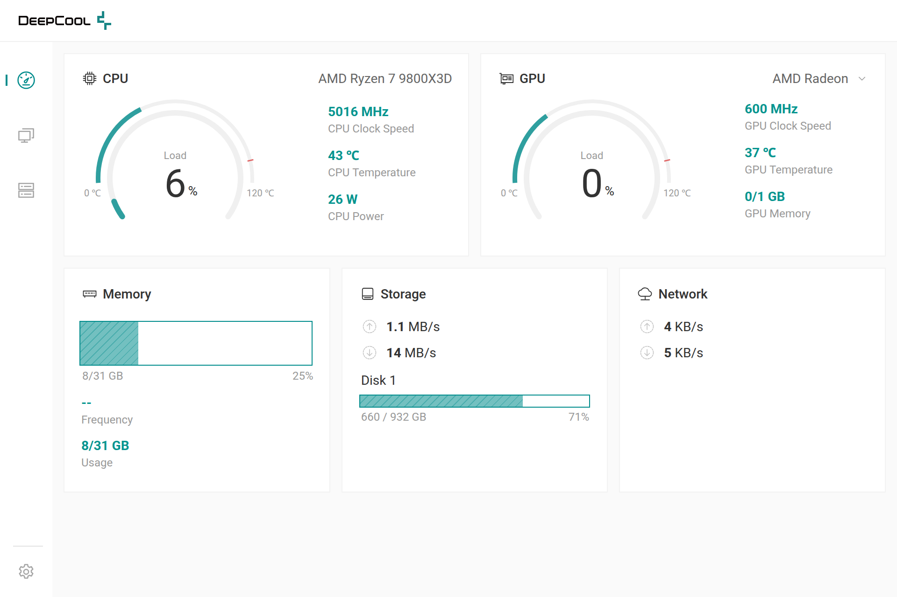
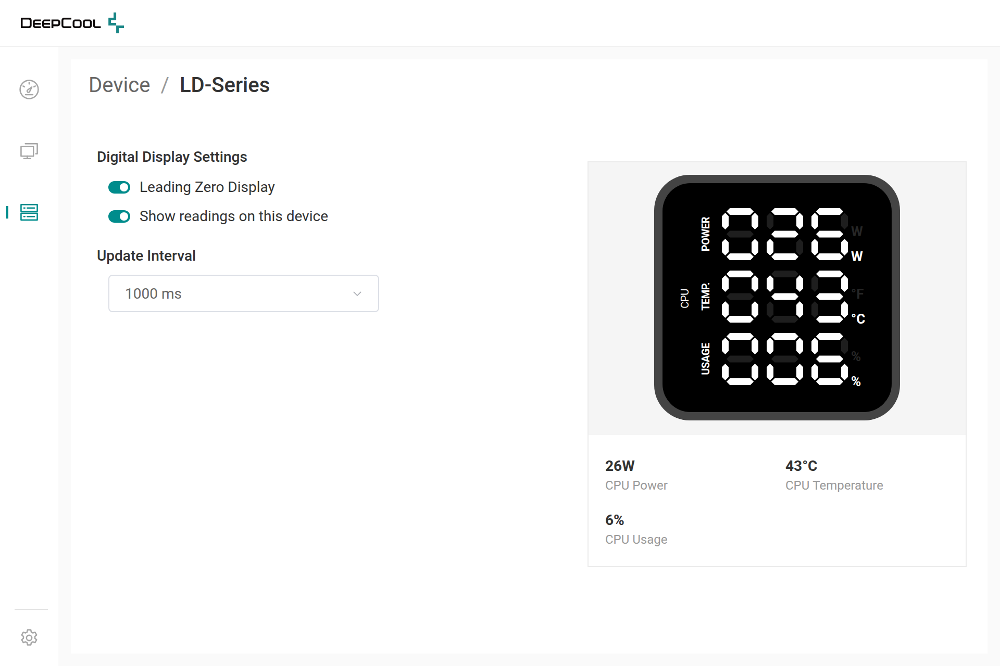
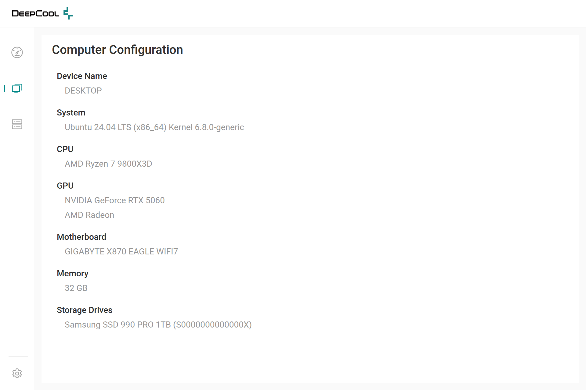
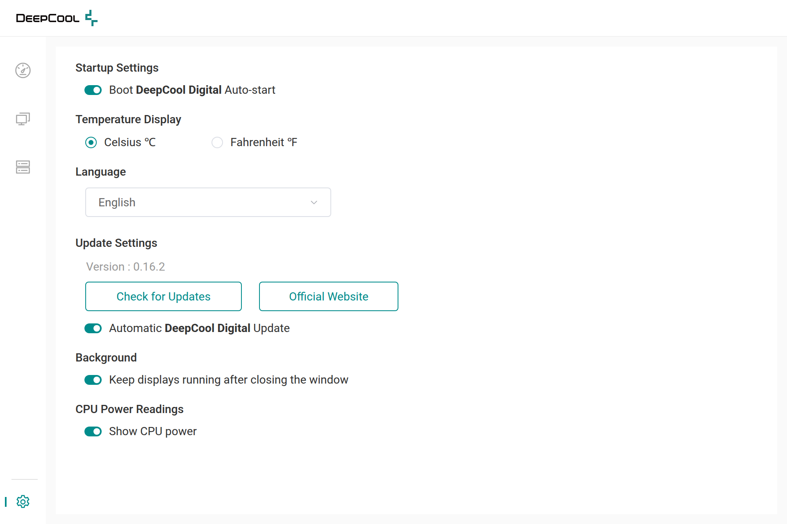

# DeepCool Digital Desktop

[](LICENSE)


[](https://github.com/tajbinkhan/deepcool-digital-desktop/releases/latest)

Control the digital displays of DeepCool CPU coolers and cases on Linux, from a desktop app.
See live system readings, pick what your device shows, and let it run in the background — including
automatically when you sign in. The device code is pure Rust; the window is a [Tauri](https://tauri.app)
app with a Svelte interface.



| Device settings with live preview | Computer details | Settings |
|---|---|---|
|  |  |  |

> This project is a fork of [**deepcool-digital-linux**](https://github.com/Nortank12/deepcool-digital-linux)
> by **Nortank12** and its contributors, who wrote the device controller that talks to the hardware.
> It adds a desktop app, background and sign-in support, Linux packages and some fixes.
> See [Credits](#credits).

## Table of contents

- [Features](#features)
- [Supported devices](#supported-devices)
- [Install](#install)
- [Set up the app](#set-up-the-app)
- [Run in the background and at sign-in](#run-in-the-background-and-at-sign-in)
- [Command-line controller](#command-line-controller)
- [Running as a system service instead](#running-as-a-system-service-instead)
- [CPU power readings](#cpu-power-readings)
- [Updates](#updates)
- [Build from source](#build-from-source)
- [Troubleshooting](#troubleshooting)
- [Contributing](#contributing)
- [Credits](#credits)
- [License](#license)

## Features

- **Desktop app** with a live dashboard (CPU and GPU load, temperature, clock and power, GPU memory;
  memory use, disk speed and space, network speed), your computer's hardware details, and per-device
  settings with a live preview of the display. Choose which GPU to show when you have several.
- **Seven languages**: English, Deutsch, Español, Français, Italiano, Português and Русский; °C or °F.
- **A native Linux window**: your desktop draws the title bar, so buttons, shadow, resizing and snapping
  match the rest of your system on GNOME, KDE and others.
- **Only valid choices**: display modes, rotation, alarm and leading zeros are shown only where the
  selected device supports them.
- **Runs in the background**: closing the window keeps your displays running. A tray icon brings the window
  back or quits the app; only one copy ever runs.
- **Light on resources**: displays run inside the app instead of as separate programs, and sensors are read
  only while needed. In the background (window closed) it uses about 45 MB of memory and 0.1% CPU; with the
  window open, about 190 MB and 1% CPU.
- **Starts automatically**: connected devices show readings as soon as the app runs, and the app can start
  without a window when you sign in. Displays that stop unexpectedly (for example after being unplugged)
  are retried.
- **CPU power on the display**: one switch (with your administrator password) lets the display show CPU
  watts on systems that restrict the CPU energy counter.
- **Updates from inside the app**: the app tells you when a new version is out, then downloads it, verifies
  its checksum and installs it with your administrator password. Then select **Restart now**.
- **Several devices at once**, each with its own settings.
- **No root needed**: packages install udev rules that give your desktop session access to the device.
- **Packages** for Debian/Ubuntu (`.deb`), Fedora/openSUSE (`.rpm`), Arch (`.pkg.tar.zst`), plus a portable
  `.tar.gz`.
- **The original command-line controller** is included for scripts and services, with a fix so it keeps
  running when the CPU power sensor can't be read.

## Supported devices

Device support comes from the controller of the original project.

| CPU air coolers | | CPU liquid coolers | | Cases | |
|---|:-:|---|:-:|---|:-:|
| AG300 DIGITAL | ✅ | LD240 | ✅ | CH170 DIGITAL | ✔️ |
| AG400 DIGITAL | ✅ | LD360 | ✅ | CH270 DIGITAL | ✔️ |
| AG500 DIGITAL | ✅ | LP240 | ✔️ | CH360 DIGITAL | ✅ |
| AG620 DIGITAL | ✅ | LP360 | ✔️ | CH510 MESH DIGITAL | ✅ |
| AK400 DIGITAL / DIGITAL SE | ✅ | LQ240 | ✅ | CH560 DIGITAL | ✅ |
| AK400 DIGITAL PRO | ✅ | LQ360 | ✅ | CH690 DIGITAL | ✔️ |
| AK400 G2 DIGITAL NYX | ✅ | LS520 SE DIGITAL | ✅ | MORPHEUS | ✅ |
| AK500 DIGITAL | ✅ | LS720 SE DIGITAL | ✅ | | |
| AK500 DIGITAL PRO | ✅ | | | | |
| AK500 G2 DIGITAL NYX | ✅ | | | | |
| AK500S DIGITAL / DIGITAL SE | ✅ | | | | |
| AK620 DIGITAL / DIGITAL SE | ✅ | | | | |
| AK620 DIGITAL PRO | ✅ | | | | |
| AK620 G2 DIGITAL NYX | ✅ | | | | |
| AK700 DIGITAL NYX | ✅ | | | | |
| ASSASSIN IV VC VISION | ✅ | | | | |

✅ Fully supported · ✔️ Partially supported (some display modes are unavailable on the device)

The MYSTIQUE series (LCD screens) is not supported. If your device is missing, run the app anyway and open
**Device**: it may still be detected (the list refreshes every few seconds). USB IDs and display mappings are documented in
[device-list](device-list/README.md).

## Install

Download the package for your distribution from the
[Releases page](https://github.com/tajbinkhan/deepcool-digital-desktop/releases), or
[build it yourself](#build-from-source).

**Debian, Ubuntu, Linux Mint, Pop!_OS**

```bash
sudo apt install ./deepcool-digital-gui_*_amd64.deb
```

**Fedora, openSUSE**

```bash
sudo dnf install ./deepcool-digital-gui-*.x86_64.rpm
```

**Arch Linux, Manjaro, EndeavourOS**

```bash
sudo pacman -U deepcool-digital-gui-*-x86_64.pkg.tar.zst
```

**Any distribution (portable)**: extract the `.tar.gz` and run `DeepCoolDigital/AppRun`. Portable builds
cannot install the USB access rules for you; install them once as described in
[Troubleshooting](#the-app-says-usb-access-is-denied-or-no-device-is-found). They also can't update
themselves, and they don't add the app to your app menu.

The packages install:

| Path | What it is |
|---|---|
| `/usr/bin/deepcool-digital-gui` | The desktop app (also in your app menu as **DeepCool Digital**) |
| `/usr/bin/deepcool-digital-linux` | The command-line controller |
| `/usr/lib/deepcool-digital/deepcool-digital-cpu-power` | Helper the app uses to [allow CPU power readings](#cpu-power-readings) |
| `/usr/lib/deepcool-digital/deepcool-digital-update` | Helper the app uses to [install updates](#updates) |
| `/usr/lib/udev/rules.d/70-deepcool-digital.rules` | Gives your desktop session access to DeepCool USB devices |

Requirements: x86_64, glibc 2.35 or newer (Ubuntu 22.04+, Debian 12+, Fedora 36+, Arch), and a graphical
desktop (Wayland or X11). The `.deb`, `.rpm` and Arch packages install the WebKitGTK and tray icon libraries
the window needs; the portable `.tar.gz` expects them to be installed already (`libwebkit2gtk-4.1` and
`libayatana-appindicator3`).

### Upgrading from 0.15 or earlier

Version 0.16 replaces the earlier egui window with a new app, installed under the same name. Install it over
the old version (or accept the update offered inside the app): saved device settings, the sign-in entry and
the CPU power permission carry over. Displays now start on their own when the app runs; there are no
**Start display** / **Stop display** buttons any more (use **Show readings on this device** instead). The
activity log was removed; errors are shown in the app.

## Set up the app

1. Open **DeepCool Digital** from your app menu. Do not run it as root.
2. The **Dashboard** shows live readings. Select **Device** in the left bar: your device is listed. If it
   isn't, unplug and reconnect it once so the new USB rule applies.
3. The device starts showing readings right away. Select it to change its settings, such as the display
   mode or **Leading Zero Display**; changes apply within a second, and the preview shows what the display
   shows. **Show readings on this device** turns the display off and on.

Settings are saved per device in `~/.config/deepcool-digital/settings.json`; settings from earlier versions
are kept. The temperature unit (°C or °F) and the language are chosen in **Settings** and apply to every
device.

## Run in the background and at sign-in

These are in **Settings**:

| Setting | What it does |
|---|---|
| **Boot DeepCool Digital Auto-start** | Starts the app without a window when you sign in, which then starts your displays. |
| **Keep displays running after closing the window** | On by default. Closing the window leaves the app running in the tray, using little memory. Click its tray icon (or open **DeepCool Digital** from the app menu) to show it again. |

Each device's **Show readings on this device** switch decides whether that device runs. A display that
stops unexpectedly (for example after unplugging) is started again within about 15 seconds.

The app starts when your desktop session starts. If your system signs you in automatically, that is at
boot. It runs as your user rather than as a system service, because the USB rules give access to the
signed-in desktop session. If you need the display before anyone signs in, see
[Running as a system service instead](#running-as-a-system-service-instead).

The sign-in entry is the file `~/.config/autostart/deepcool-digital.desktop`. It runs
`deepcool-digital-gui --background`.

### Tray icon

While the app runs, with or without its window, its icon is in the system tray (the top bar on GNOME, the
panel on KDE and others).

- **Left click** or **Open DeepCool Digital** shows the window.
- **Stop displays and quit** stops every display and exits the app.

Ubuntu's desktop shows tray icons out of the box, and so do KDE Plasma, Cinnamon, XFCE and MATE. Plain GNOME
(for example on Fedora or Debian) needs the
[AppIndicator and KStatusNotifierItem Support](https://extensions.gnome.org/extension/615/appindicator-support/)
extension; without it the app still runs in the background, and you can open it from the app menu.

## Command-line controller

The controller from the original project is installed as `deepcool-digital-linux`, for scripts and system
services. The desktop app doesn't need it: it drives the displays itself, with the same device code.

```
Usage: deepcool-digital-linux [OPTIONS]

Options:
  -m, --mode <MODE>       Change the display mode of your device
  -s, --secondary <MODE>  Change the secondary display mode of your device (if supported)
      --pid <ID>          Specify the Product ID if multiple devices are connected
      --gpuid <VENDOR:ID> Specify the nth GPU of a specific vendor to monitor (use ID 0 for integrated GPU)

  -u, --update <MILLISEC> Change the update interval of the display [default: 1000]
  -f, --fahrenheit        Change the temperature unit to °F
  -a, --alarm             Enable the alarm
  -r, --rotate <DEGREE>   Rotate the display (LP Series only)
  -z, --zeros             Display leading zeros (LD Series only)

Commands:
  -l, --list         Print Product ID of the connected devices
  -g, --gpulist      Print all available GPUs
  -h, --help         Print help
  -v, --version      Print version
```

With several devices connected, list them and run one controller per product ID:

```bash
deepcool-digital-linux --list
```

```
Device list [PID | Name]
-----
4 | AK500S-DIGITAL
7 | MORPHEUS
```

```bash
deepcool-digital-linux --pid 4
```

The desktop app's background and sign-in features replace the need for a hand-written service in most
cases.

## Running as a system service instead

A system service starts at boot, before anyone signs in, and runs as root. Use it only if you don't want the
desktop app's automatic start, and **never run both at once**: two programs writing to the same display
conflict.

<details>
<summary><b>systemd (Debian, Ubuntu, Fedora, Arch and most others)</b></summary>

Create `/etc/systemd/system/deepcool-digital.service`:

```ini
[Unit]
Description=DeepCool Digital

[Service]
ExecStart=/usr/bin/deepcool-digital-linux
Restart=on-failure
RestartSec=5s

[Install]
WantedBy=multi-user.target
# On headless servers, use this target instead if your GPU is not detected
# WantedBy=graphical.target
```

Add options such as `--pid 4 --mode cpu_temp` to `ExecStart` as needed, then enable it:

```bash
sudo systemctl enable --now deepcool-digital
```

</details>

<details>
<summary><b>OpenRC (Gentoo, Artix and others)</b></summary>

Create `/etc/init.d/deepcool-digital`:

```sh
#!/sbin/openrc-run

description="DeepCool Digital"
command="/usr/bin/deepcool-digital-linux"
command_args=""
command_background=1
pidfile="/run/deepcool-digital.pid"
```

```bash
sudo chmod +x /etc/init.d/deepcool-digital
```

```bash
sudo rc-update add deepcool-digital default
```

</details>

NixOS users can use the `services.hardware.deepcool-digital-linux` module from Nixpkgs, which packages the
original project; see its [README](https://github.com/Nortank12/deepcool-digital-linux#installation).

## CPU power readings

Displays that show CPU power (watts) need to read the CPU's energy counter, for example
`/sys/class/powercap/intel-rapl:0/energy_uj`. Most distributions let only root read it, so by default the
display shows 0 W and the app shows "--".

When that is the case, the dashboard shows **Allow** next to CPU Power. Select it (or turn on **Show CPU
power** under **CPU Power Readings** in **Settings**) and enter your administrator password. The app makes
the counter readable now and after every restart, and readings start within a second. Turning the switch
off restores the default. If your kernel exposes none of the supported counters (`intel_rapl`, `amd_energy`
or `zenergy`), Settings says so and CPU power can't be shown.

Allowing it makes the energy counter readable by every user on the computer. Linux restricts it because
precise energy readings have been used in side-channel attacks
([CVE-2020-8694](https://nvd.nist.gov/vuln/detail/CVE-2020-8694)); on a personal computer the risk is low.

Behind the switch, the helper `/usr/lib/deepcool-digital/deepcool-digital-cpu-power` runs as root through
polkit. It writes `/etc/udev/rules.d/71-deepcool-digital-cpu-power.rules` and changes the counters'
permissions. Uninstalling the `.deb` or `.rpm` removes that rule. Without polkit (or from the portable
build), run it yourself:

```bash
sudo /usr/lib/deepcool-digital/deepcool-digital-cpu-power enable
```

Use `disable` to undo it, or `status` to check.

## Updates

The app's version number is shown in **Settings**, under **Update Settings**.

With **Automatic DeepCool Digital Update** on (the default), the app asks GitHub for the latest release when
it starts and every six hours. It never installs anything without you. You can also select **Check for
Updates** at any time. When a newer version is available, a red dot appears on the Settings icon:

1. Select **Update now**. The app downloads the package for your system (`.deb`, `.rpm` or Arch) and checks
   it against the release's `SHA256SUMS`.
2. Enter your administrator password. The helper
   `/usr/lib/deepcool-digital/deepcool-digital-update` installs it with your package manager (`apt`, `dnf`,
   `zypper` or `pacman`). It only installs the DeepCool Digital package.
3. Select **Restart now**. The new version starts, and your displays start again.

Portable and source builds can't update themselves; for those, **Open download page** opens the release
page. Downloads are kept in `~/.cache/deepcool-digital/updates` until the update is installed.

## Build from source

The repository is a Cargo workspace:

| Folder | Contents |
|---|---|
| `crates/core/` | Device drivers and sensor readers, shared by the app and the controller |
| `crates/helpers/` | Small helpers the app runs as root through polkit (CPU power access, installing updates) |
| `src/` | The command-line controller (`deepcool-digital-linux`), from the original project |
| `app/` | The desktop app: a [Tauri](https://tauri.app) backend in `app/src-tauri/` and a Svelte interface in `app/src/` |
| `xtask/` | The packaging tool, run as `cargo xtask package` |
| `packaging/` | udev rules, desktop entry, icon and install script used by the packages |
| `device-list/` | USB IDs and display mappings for each device family |

### 1. Install the build dependencies

You need [Rust](https://rustup.rs/) (stable), a C toolchain, `pkg-config`, the libudev headers, the WebKitGTK
and tray icon development libraries, and [Node.js](https://nodejs.org/) 22.12 or newer with
[pnpm](https://pnpm.io/) for the app's interface.

<details>
<summary><b>Debian / Ubuntu</b></summary>

```bash
sudo apt install build-essential pkg-config libudev-dev curl libwebkit2gtk-4.1-dev libayatana-appindicator3-dev librsvg2-dev
```

```bash
curl --proto '=https' --tlsv1.2 -sSf https://sh.rustup.rs | sh
```

</details>

<details>
<summary><b>Fedora</b></summary>

```bash
sudo dnf install gcc pkgconf-pkg-config systemd-devel rustup webkit2gtk4.1-devel libayatana-appindicator-gtk3-devel librsvg2-devel
```

```bash
rustup-init
```

</details>

<details>
<summary><b>Arch Linux</b></summary>

```bash
sudo pacman -S base-devel rustup webkit2gtk-4.1 libayatana-appindicator librsvg
```

```bash
rustup default stable
```

</details>

### 2. Build and run

```bash
git clone https://github.com/tajbinkhan/deepcool-digital-desktop.git
```

```bash
cd deepcool-digital-desktop
```

```bash
pnpm --dir app install && pnpm --dir app build
```

```bash
cargo build --release --features deepcool-digital-app/custom-protocol
```

```bash
./target/release/deepcool-digital-app
```

To work on the interface with live reload, run `pnpm --dir app tauri dev` instead. In a plain browser
(`pnpm --dir app dev`, then open http://localhost:1420) the interface shows sample data.

To use the USB device without root when running from source, install the rules once:

```bash
sudo cp packaging/70-deepcool-digital.rules /usr/lib/udev/rules.d/ && sudo udevadm control --reload-rules
```

Then unplug and reconnect the device.

### 3. Test

```bash
cargo test --workspace
```

```bash
pnpm --dir app check
```

With a supported device connected, this prints live readings:

```bash
cargo run -p deepcool-core --example readings
```

### 4. Build packages

```bash
cargo xtask package --formats deb,arch,tar
```

Packages and a `SHA256SUMS` file are written to `dist/`. The available formats are `deb`, `rpm`, `arch`, `tar`
and `appimage`, and the default is `deb,rpm,arch,tar`. They need these tools:

| Format | Tools |
|---|---|
| `deb` | `dpkg-deb`, `dpkg-shlibdeps` |
| `rpm` | `rpmbuild` |
| `arch` | `tar`, `zstd` |
| `tar` | `tar` |
| `appimage` | `mksquashfs` and the official [type2 runtime](https://github.com/AppImage/type2-runtime/releases), passed with `--runtime <path>` |

Packages use the build machine's architecture and its glibc version as the minimum. Build on the oldest
distribution you want to support. The package version comes from `app/src-tauri/Cargo.toml`.

More details about the app, packaging and test hooks are in [GUI.md](GUI.md).

## Troubleshooting

#### The app says USB access is denied, or no device is found

- Unplug and reconnect the device; the **Device** page refreshes on its own within a few seconds.
- Check that the rule is installed: `/usr/lib/udev/rules.d/70-deepcool-digital.rules`. Portable builds and
  source builds need it installed manually (see [Build and run](#2-build-and-run)).
- The rule gives access to the signed-in desktop session. Over SSH or on a system without systemd-logind,
  give access another way, or run the command-line controller as root.

#### The display flickers or shows the wrong values

Another program may also be driving it. Stop any `deepcool-digital` system service
(`sudo systemctl disable --now deepcool-digital`) and any other copy of the controller.

#### CPU power shows 0 W

Select **Allow** next to CPU Power on the dashboard; see [CPU power readings](#cpu-power-readings). If the
password prompt doesn't appear, check that polkit is installed (`pkexec` on Debian and Ubuntu).

#### The tray icon's menu is empty or missing

On GNOME, make sure only one AppIndicator extension is enabled: Ubuntu ships **Ubuntu AppIndicators**, and
installing **AppIndicator and KStatusNotifierItem Support** as well runs the same code twice.

#### The dock or taskbar shows a generic icon

The icon comes from the app's desktop entry, `/usr/share/applications/deepcool-digital.desktop`, which the
packages install. Copies run from a source build or the portable `.tar.gz` don't have one, so the desktop
shows a generic icon.

#### Where are the logs?

Problems with a device are shown on its page in the app. For more detail, start the app from a terminal
(`deepcool-digital-gui`) and watch its output.

## Contributing

Bug reports and pull requests are welcome. When reporting a device problem, include the output of
`deepcool-digital-linux --list` and any error the app shows. Support for new devices
belongs in the controller (`src/`); consider sending it to the
[original project](https://github.com/Nortank12/deepcool-digital-linux) as well, so everyone benefits.

Before opening a pull request:

```bash
cargo fmt -p deepcool-digital-app -p deepcool-core -p xtask && cargo clippy --workspace --all-targets && cargo test --workspace
```

```bash
pnpm --dir app check
```

The controller in `src/` keeps the original project's formatting so upstream changes stay easy to merge.

Maintainers: see [RELEASING.md](RELEASING.md) for how to publish a new version.

## Credits

- **[Nortank12](https://github.com/Nortank12)** and the contributors of
  [deepcool-digital-linux](https://github.com/Nortank12/deepcool-digital-linux): the device controller,
  device support, protocol research and device documentation this project is built on.
- **[Tajbin Khan](https://github.com/tajbinkhan)**: the desktop app (rebuilt with Tauri in 0.16), the shared
  device library, background and sign-in support, single-instance handling, CPU power access, in-app
  updates, packaging tool and CPU energy sensor fix.

This project is not affiliated with or endorsed by DeepCool. DeepCool and the DeepCool logo are trademarks
of their owner and are used here only to identify the hardware this software works with.

## License

DeepCool Digital Desktop is free and open-source software, licensed under the
**GNU General Public License v3.0**. The full text is in [LICENSE](LICENSE).

```
Copyright (C) Nortank12 and deepcool-digital-linux contributors
Copyright (C) 2026 Tajbin Khan

This program is free software: you can redistribute it and/or modify it under the terms of the
GNU General Public License as published by the Free Software Foundation, version 3.

This program is distributed in the hope that it will be useful, but WITHOUT ANY WARRANTY; without
even the implied warranty of MERCHANTABILITY or FITNESS FOR A PARTICULAR PURPOSE. See the
GNU General Public License for more details.
```

The original project is GPL-3.0 licensed, and this project is a modified version of it, so it is
GPL-3.0 as well. You may use, study, share and change it. If you distribute it or a modified version,
you must provide the source code under the same license and keep these copyright notices.
